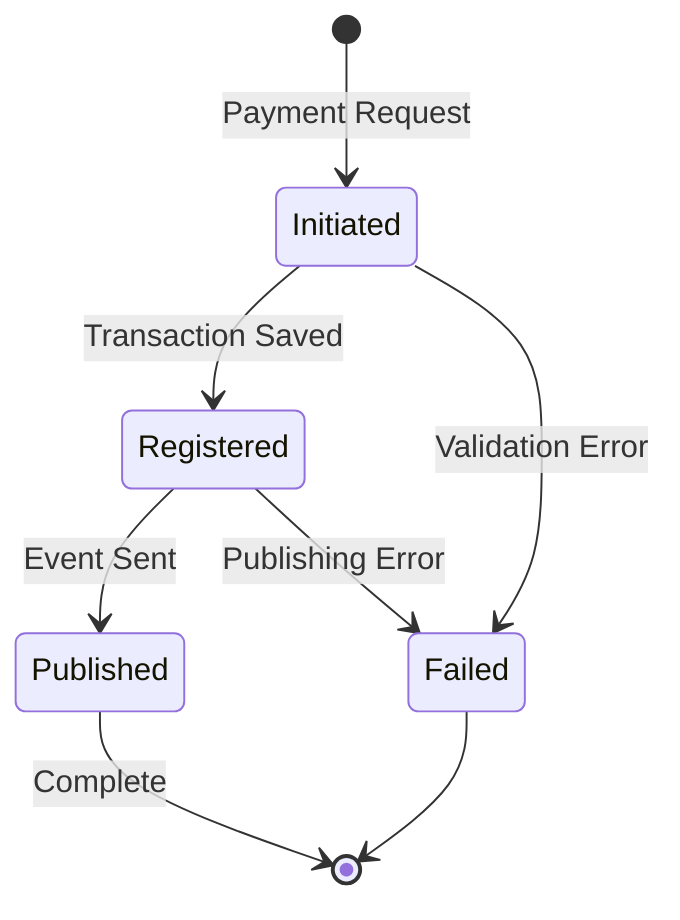
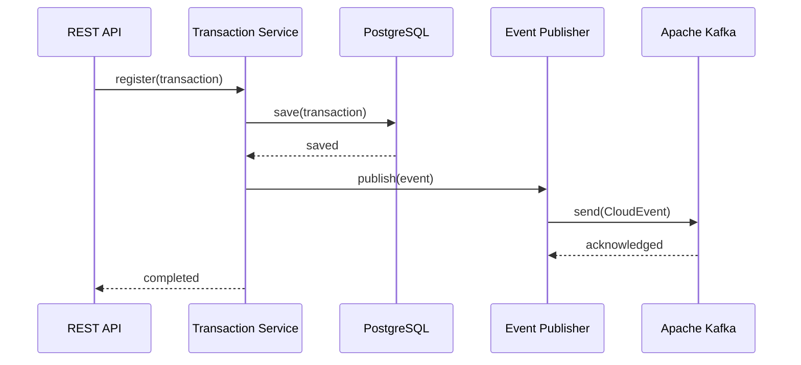

# Paymentic Wallet - Technical Specification

## API Reference

### REST API Endpoints

#### 1. Create Payout

Creates a new payout transaction for a merchant.

**Endpoint**: `POST /payouts`

**Request**:

```http
POST /payouts HTTP/1.1
Content-Type: application/json

{
  "amount": {
    "value": "100.00",
    "currency": "USD"
  },
  "seller": {
    "account": "SELLER_ACCOUNT_ID"
  },
  "note": "Monthly payout for October 2024"
}
```

**Response**:

```http
HTTP/1.1 201 Created
Content-Type: application/json

{
  "transactionId": "550e8400-e29b-41d4-a716-446655440000",
  "status": "PROCESSED",
  "note": "Monthly payout for October 2024"
}
```

**Status Codes**:

| Code | Description |
|------|-------------|
| 201 | Payout successfully created |
| 400 | Invalid request data |
| 500 | Internal server error |

## Domain Models and Entities

### PaymentTransaction

The core entity representing a payment transaction.

| Property | Type | Description | Required | Constraints |
|----------|------|-------------|----------|-------------|
| `id` | `UUID` | Unique transaction identifier | Yes | Primary Key |
| `amount` | `String` | Transaction amount | Yes | Numeric string |
| `currency` | `String` | Currency code | Yes | ISO 4217 format |
| `checkout` | `CheckoutId` | Checkout session identifier | Yes | Embedded value object |
| `buyer` | `BuyerInfo` | Buyer information | Yes | Embedded value object |
| `paymentOrder` | `PaymentOrderId` | Payment order reference | Yes | Embedded value object |
| `sellerInfo` | `SellerInfo` | Seller information | Yes | Embedded value object |

**Methods**:

```java
// Factory method for creating new payment transactions
public static PaymentTransaction newPaymentTransactionRegistered(
    UUID id, 
    String amount, 
    String currency, 
    CheckoutId checkout, 
    BuyerInfo buyer,
    PaymentOrderId paymentOrder, 
    SellerInfo sellerInfo
)
```

### RefundTransaction

Entity representing a refund transaction.

| Property | Type | Description | Required | Constraints |
|----------|------|-------------|----------|-------------|
| `id` | `UUID` | Unique transaction identifier | Yes | Primary Key |
| `amount` | `String` | Refund amount | Yes | Numeric string |
| `currency` | `String` | Currency code | Yes | ISO 4217 format |
| `buyer` | `BuyerInfo` | Buyer information | Yes | Embedded value object |
| `paymentOrder` | `PaymentOrderId` | Original payment order | Yes | Embedded value object |
| `sellerInfo` | `SellerInfo` | Seller information | Yes | Embedded value object |

**Note**: RefundTransaction does not include a `checkout` field as refunds are not associated with checkout sessions.

### Value Objects

#### BuyerInfo

| Property | Type | Description |
|----------|------|-------------|
| `document` | `String` | Buyer's document/ID number |
| `name` | `String` | Buyer's full name |

#### SellerInfo

| Property | Type | Description |
|----------|------|-------------|
| `id` | `String` | Seller's unique identifier |

#### CheckoutId

| Property | Type | Description |
|----------|------|-------------|
| `id` | `String` | Checkout session identifier |

#### PaymentOrderId

| Property | Type | Description |
|----------|------|-------------|
| `id` | `String` | Payment order identifier |

#### TransactionId

| Property | Type | Description |
|----------|------|-------------|
| `id` | `UUID` | Transaction unique identifier |

## Services

### PaymentTransactionService

Handles payment transaction operations.

**Methods**:

| Method | Parameters | Return Type | Description |
|--------|------------|-------------|-------------|
| `register` | `PaymentTransaction` | `void` | Persists transaction and publishes event |

**Behavior**:
1. Saves transaction to database (transactional)
2. Creates `TransactionRegisteredEvent`
3. Publishes event to Kafka topic

### RefundTransactionService

Manages refund transaction operations.

**Methods**:

| Method | Parameters | Return Type | Description |
|--------|------------|-------------|-------------|
| `register` | `RefundTransaction` | `void` | Persists refund and publishes event |

**Behavior**:
1. Saves refund to database (transactional)
2. Creates `TransactionRegisteredEvent` (without checkout)
3. Publishes event to Kafka topic

## State Management

### Transaction States

The system implements an **event-driven state machine** for transaction lifecycle:



### State Transitions

| From State | To State | Trigger | Side Effects |
|------------|----------|---------|--------------|
| None | Initiated | API Request | Transaction object created |
| Initiated | Registered | Repository save | Database record created |
| Registered | Published | Event publish | Kafka message sent |
| Any | Failed | Exception | Error logged, rollback |

### Transactional Boundaries

- **Database Transactions**: Spring `@Transactional` ensures atomicity
- **Event Publishing**: Asynchronous with retry mechanism
- **Compensation**: Failed events trigger compensating transactions

## Events

### TransactionRegisteredEvent

The primary domain event for transaction registration.

**Event Structure**:

| Field | Type | Description | Required |
|-------|------|-------------|----------|
| `transaction` | `TransactionId` | Transaction identifier | Yes |
| `seller` | `SellerInfo` | Seller information | Yes |
| `payment` | `PaymentOrderId` | Payment order reference | Yes |
| `checkout` | `CheckoutId` | Checkout session | No (null for refunds) |
| `buyer` | `BuyerInfo` | Buyer information | Yes |
| `amount` | `String` | Transaction amount | Yes |
| `currency` | `String` | Currency code | Yes |
| `at` | `LocalDateTime` | Transaction timestamp | Yes |
| `operationType` | `OperationType` | PAYMENT or REFUND | Yes |

**CloudEvents Metadata**:

| Attribute | Value/Pattern | Description |
|-----------|---------------|-------------|
| `type` | `funny-bunny.xyz.merchant-account.v1.transaction.registered` | Event type identifier |
| `source` | `/transactions/{transactionId}` | Event source URI |
| `subject` | `payment` or `refund` | Operation type |
| `id` | UUID | Unique event identifier |
| `datacontenttype` | `application/json` | Content type |
| `specversion` | `1.0` | CloudEvents specification version |

**Custom Extensions**:

| Extension | Values | Description |
|-----------|--------|-------------|
| `audience` | `INTERNAL_BOUNDED_CONTEXT` | Target audience |
| `eventcontext` | `DOMAIN` | Event context type |

### Event Flow



## Kafka Integration

### Topics

| Topic Name | Purpose | Message Type | Partitioning |
|------------|---------|--------------|--------------|
| `merchant-account` | Transaction events | CloudEvents | By seller ID |

### Consumer Groups

| Consumer | Group ID | Purpose |
|----------|----------|---------|
| PaymentOrderApprovedBridge | `wallet-payment-processor` | Process approved payments |
| RefundApprovedBridge | `wallet-refund-processor` | Process approved refunds |

### Message Guarantees

- **Delivery**: At-least-once delivery semantics
- **Ordering**: Preserved per partition (seller)
- **Retention**: Configurable (default 7 days)
- **Replication**: Factor of 3 for high availability

## Repository Layer

### PaymentTransactionRepository

```java
public interface PaymentTransactionRepository 
    extends JpaRepository<PaymentTransaction, UUID> {
    // Inherits standard CRUD operations
}
```

### RefundTransactionRepository

```java
public interface RefundTransactionRepository 
    extends JpaRepository<RefundTransaction, UUID> {
    // Inherits standard CRUD operations
}
```

### Database Schema

**Table: payment_seller_transaction**

| Column | Type | Constraints |
|--------|------|-------------|
| transaction_id | UUID | PRIMARY KEY |
| amount | VARCHAR(255) | NOT NULL |
| currency | VARCHAR(3) | NOT NULL |
| checkout_id | VARCHAR(255) | NOT NULL |
| buyer_document | VARCHAR(255) | NOT NULL |
| buyer_name | VARCHAR(255) | NOT NULL |
| payment_order_id | VARCHAR(255) | NOT NULL |
| seller_id | VARCHAR(255) | NOT NULL |

**Table: refund_seller_transaction**

| Column | Type | Constraints |
|--------|------|-------------|
| transaction_id | UUID | PRIMARY KEY |
| amount | VARCHAR(255) | NOT NULL |
| currency | VARCHAR(3) | NOT NULL |
| buyer_document | VARCHAR(255) | NOT NULL |
| buyer_name | VARCHAR(255) | NOT NULL |
| payment_order_id | VARCHAR(255) | NOT NULL |
| seller_id | VARCHAR(255) | NOT NULL |

## Configuration

### Application Properties

**Database Configuration**:

```yaml
spring:
  datasource:
    url: jdbc:postgresql://localhost:5432/wallet
    username: ${DB_USERNAME}
    password: ${DB_PASSWORD}
  jpa:
    hibernate:
      ddl-auto: update
    properties:
      hibernate:
        dialect: org.hibernate.dialect.PostgreSQLDialect
```

**Kafka Configuration**:

```yaml
spring:
  kafka:
    bootstrap-servers: ${KAFKA_BOOTSTRAP_SERVERS}
    producer:
      key-serializer: org.apache.kafka.common.serialization.StringSerializer
      value-serializer: io.cloudevents.kafka.CloudEventSerializer
    consumer:
      group-id: ${KAFKA_CONSUMER_GROUP}
      key-deserializer: org.apache.kafka.common.serialization.StringDeserializer
      value-deserializer: io.cloudevents.kafka.CloudEventDeserializer
```

### Environment-Specific Configurations

| Environment | Profile | Key Differences |
|-------------|---------|-----------------|
| Development | `dev` | Local database, single Kafka broker |
| Staging | `kind` | Kubernetes deployment, 3 Kafka brokers |
| Production | `prod` | High availability, SSL/TLS enabled |

## Error Handling

### Exception Types

| Exception | Cause | Handling |
|-----------|-------|----------|
| `DataIntegrityViolationException` | Duplicate transaction ID | Return 409 Conflict |
| `InvalidRequestException` | Malformed request data | Return 400 Bad Request |
| `KafkaException` | Event publishing failure | Retry with exponential backoff |
| `DatabaseException` | Connection issues | Circuit breaker pattern |

### Retry Policies

```yaml
kafka:
  retry:
    max-attempts: 3
    backoff:
      initial: 1000ms
      multiplier: 2
      max: 10000ms
```

## Monitoring and Observability

### Metrics

| Metric | Type | Description |
|--------|------|-------------|
| `transaction.created.count` | Counter | Total transactions created |
| `transaction.created.duration` | Timer | Transaction creation latency |
| `event.published.count` | Counter | Events published to Kafka |
| `event.publish.failures` | Counter | Failed event publications |

### Health Checks

| Endpoint | Checks |
|----------|--------|
| `/actuator/health` | Database connectivity, Kafka connectivity |
| `/actuator/metrics` | Application metrics |
| `/actuator/info` | Application version and metadata |

### Distributed Tracing

- **Framework**: OpenTelemetry
- **Trace Context**: Propagated via CloudEvents extensions
- **Span Attributes**: Transaction ID, Operation Type, Seller ID

## Performance Optimizations

### Database Optimizations

- **Indexes**: On `seller_id`, `payment_order_id`, `transaction_id`
- **Connection Pooling**: HikariCP with 20 connections
- **Query Optimization**: Lazy loading for associations

### Kafka Optimizations

- **Batch Processing**: Producer batching enabled
- **Compression**: Snappy compression for messages
- **Partitioning**: By seller ID for ordering guarantees

### Caching Strategy

- **Level 2 Cache**: Disabled for transaction entities (write-heavy)
- **Query Cache**: Enabled for reference data lookups
- **Application Cache**: Not implemented (stateless design)

## Security Specifications

### Authentication & Authorization

- **API Security**: Bearer token authentication
- **Kafka Security**: SASL/PLAIN with ACLs
- **Database Security**: SSL connections, encrypted at rest

### Data Protection

- **PII Handling**: Buyer information encrypted in transit
- **Audit Logging**: All transactions logged with correlation IDs
- **Compliance**: GDPR and PCI DSS considerations

This technical specification provides a comprehensive reference for developers working with the Paymentic Wallet component, covering all aspects of its implementation, configuration, and operation.