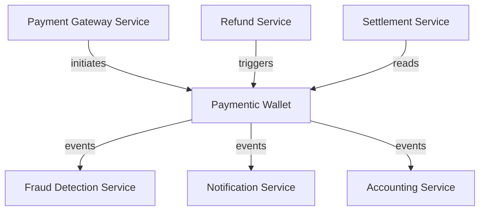
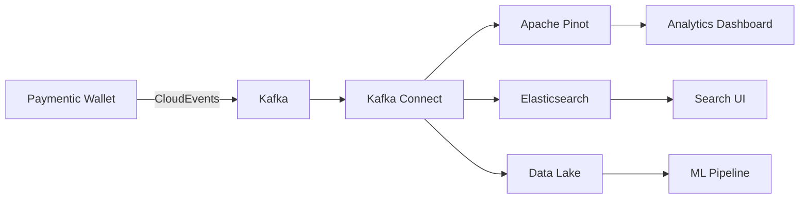

# Paymentic Wallet - Related Components

## Dependencies Overview

The Paymentic Wallet relies on a carefully selected set of dependencies that provide core functionality, infrastructure support, and integration capabilities. Below is a comprehensive breakdown of all dependencies and their roles in the system.

## Core Framework Dependencies

### Spring Boot Framework

| Dependency | Version | Purpose | Critical |
|------------|---------|---------|----------|
| `spring-boot-starter-parent` | 3.2.1 | Parent POM providing dependency management | ✅ Yes |
| `spring-boot-starter-web` | 3.2.1 | REST API support with embedded Tomcat | ✅ Yes |
| `spring-boot-starter-data-jpa` | 3.2.1 | JPA/Hibernate ORM support | ✅ Yes |
| `spring-boot-starter-actuator` | 3.2.1 | Production-ready monitoring and health checks | ✅ Yes |
| `spring-boot-starter-validation` | 3.2.1 | Bean validation support | ⚠️ Important |

**Why These Are Essential:**
- Provides the foundational framework for building microservices
- Offers auto-configuration and convention-over-configuration benefits
- Includes embedded server, reducing deployment complexity

### Data Persistence

| Dependency | Version | Purpose | Critical |
|------------|---------|---------|----------|
| `postgresql` | Runtime | PostgreSQL JDBC driver | ✅ Yes |
| `hibernate-core` | Via Spring | ORM framework | ✅ Yes |
| `HikariCP` | Via Spring | Connection pooling | ✅ Yes |
| `flyway-core` | 9.22.3 | Database migration management | ⚠️ Important |

**Integration Details:**
- PostgreSQL serves as the primary datastore for transaction records
- Hibernate manages object-relational mapping
- HikariCP provides efficient connection pooling
- Flyway ensures consistent database schema across environments

### Event Streaming

| Dependency | Version | Purpose | Critical |
|------------|---------|---------|----------|
| `spring-kafka` | 3.1.0 | Kafka integration for Spring | ✅ Yes |
| `cloudevents-kafka` | 2.5.0 | CloudEvents support for Kafka | ✅ Yes |
| `cloudevents-json-jackson` | 2.5.0 | JSON serialization for CloudEvents | ✅ Yes |
| `kafka-clients` | 3.6.0 | Core Kafka client libraries | ✅ Yes |

**Event Infrastructure:**
- Enables publishing and consuming of domain events
- CloudEvents provides standardized event format
- Supports both synchronous and asynchronous messaging patterns

### Observability & Monitoring

| Dependency | Version | Purpose | Critical |
|------------|---------|---------|----------|
| `opentelemetry-api` | 1.30.0 | Distributed tracing API | ⚠️ Important |
| `opentelemetry-sdk` | 1.30.0 | Tracing implementation | ⚠️ Important |
| `opentelemetry-exporter-otlp` | 1.30.0 | OTLP exporter for traces | ⚠️ Important |
| `micrometer-core` | Via Spring | Metrics collection | ⚠️ Important |
| `logback-classic` | Via Spring | Logging framework | ✅ Yes |

**Observability Stack:**
- OpenTelemetry provides distributed tracing across services
- Micrometer exposes metrics for Prometheus/Grafana
- Structured logging with correlation IDs

## Commonly Used Alongside

### Infrastructure Components

#### 1. API Gateway

**Common Choices:**
- **Kong Gateway**: For advanced routing and rate limiting
- **Spring Cloud Gateway**: Native Spring integration
- **AWS API Gateway**: Cloud-native solution

**Integration Pattern:**
```yaml
Routes:
  - path: /api/v1/payouts
    service: paymentic-wallet
    methods: [POST]
    authentication: required
```

#### 2. Service Mesh

**Istio Integration:**
- **Traffic Management**: Load balancing, circuit breaking
- **Security**: mTLS between services
- **Observability**: Automatic metrics and tracing

```yaml
apiVersion: networking.istio.io/v1beta1
kind: VirtualService
metadata:
  name: paymentic-wallet
spec:
  http:
  - match:
    - uri:
        prefix: /payouts
    route:
    - destination:
        host: paymentic-wallet
        port:
          number: 8080
```

#### 3. Message Brokers

**Apache Kafka Ecosystem:**

| Component | Purpose | Integration |
|-----------|---------|-------------|
| **Kafka Connect** | Data pipeline integration | Source/Sink connectors for databases |
| **Schema Registry** | Schema evolution management | CloudEvents schema validation |
| **Kafka Streams** | Stream processing | Real-time aggregations |
| **KSQL** | SQL interface for streams | Analytics queries |

#### 4. Databases & Caching

**Data Layer Components:**

| Component | Use Case | Integration Point |
|-----------|----------|-------------------|
| **Redis** | Session caching, rate limiting | Spring Data Redis |
| **Elasticsearch** | Transaction search, analytics | Kafka connector |
| **MongoDB** | Audit log storage | Change data capture |
| **Apache Pinot** | Real-time analytics | Kafka consumer |

### Microservices Ecosystem

#### Payment Processing Services



**Related Services:**

1. **Payment Gateway Service**
   - Handles external payment provider integration
   - Routes transactions to wallet service
   - Manages payment method validation

2. **Fraud Detection Service**
   - Consumes transaction events
   - Applies ML models for fraud scoring
   - Can trigger transaction reversals

3. **Notification Service**
   - Sends transaction confirmations
   - Handles email/SMS/push notifications
   - Maintains notification templates

4. **Accounting Service**
   - Maintains ledger entries
   - Generates financial reports
   - Handles reconciliation

5. **Settlement Service**
   - Processes batch settlements
   - Manages merchant payouts
   - Handles banking integrations

### Development & Testing Tools

#### Local Development

| Tool | Purpose | Configuration |
|------|---------|---------------|
| **Docker Compose** | Local environment setup | PostgreSQL, Kafka, Redis |
| **Testcontainers** | Integration testing | Automated container management |
| **WireMock** | API mocking | External service simulation |
| **Localstack** | AWS services locally | S3, SQS simulation |

**Docker Compose Example:**
```yaml
version: '3.8'
services:
  postgres:
    image: postgres:15
    environment:
      POSTGRES_DB: wallet
      POSTGRES_USER: wallet_user
      POSTGRES_PASSWORD: wallet_pass
    ports:
      - "5432:5432"
  
  kafka:
    image: confluentinc/cp-kafka:latest
    environment:
      KAFKA_ZOOKEEPER_CONNECT: zookeeper:2181
      KAFKA_ADVERTISED_LISTENERS: PLAINTEXT://localhost:9092
    ports:
      - "9092:9092"
  
  wallet-service:
    build: .
    depends_on:
      - postgres
      - kafka
    environment:
      SPRING_PROFILES_ACTIVE: dev
```

#### CI/CD Pipeline Components

| Stage | Tools | Purpose |
|-------|-------|---------|
| **Build** | Maven, Gradle | Compilation and packaging |
| **Test** | JUnit, Mockito, RestAssured | Unit and integration testing |
| **Security** | SonarQube, OWASP Dependency Check | Code quality and vulnerability scanning |
| **Container** | Docker, Buildah | Container image creation |
| **Deploy** | ArgoCD, Flux | GitOps deployment |
| **Monitor** | Prometheus, Grafana | Metrics and dashboards |

### Security Components

#### Authentication & Authorization

| Component | Integration | Purpose |
|-----------|-------------|---------|
| **Keycloak** | OIDC/OAuth2 | Identity and access management |
| **Spring Security** | Framework integration | Security filters and authentication |
| **Vault** | External secrets | Secure credential storage |
| **cert-manager** | Kubernetes | TLS certificate management |

**Keycloak Integration Example:**
```yaml
spring:
  security:
    oauth2:
      resourceserver:
        jwt:
          issuer-uri: https://keycloak.example.com/realms/paymentic
          jwk-set-uri: https://keycloak.example.com/realms/paymentic/protocol/openid-connect/certs
```

### Analytics & Reporting

#### Data Pipeline Components



**Analytics Stack:**

1. **Apache Pinot**
   - Real-time OLAP queries
   - Sub-second query latency
   - Handles high-cardinality data

2. **Elasticsearch**
   - Full-text search on transactions
   - Log aggregation
   - APM integration

3. **Apache Spark**
   - Batch processing
   - ML model training
   - Data transformation

4. **Grafana**
   - Visualization dashboards
   - Alert management
   - Multi-datasource support

### Cloud Platform Services

#### AWS Integration

| Service | Use Case | Integration Method |
|---------|----------|-------------------|
| **EKS** | Container orchestration | Kubernetes deployment |
| **RDS** | Managed PostgreSQL | JDBC connection |
| **MSK** | Managed Kafka | Kafka client |
| **CloudWatch** | Logging and metrics | CloudWatch agent |
| **Secrets Manager** | Credential management | Spring Cloud AWS |
| **X-Ray** | Distributed tracing | OpenTelemetry exporter |

#### Azure Integration

| Service | Use Case | Integration Method |
|---------|----------|-------------------|
| **AKS** | Container orchestration | Kubernetes deployment |
| **Azure Database for PostgreSQL** | Managed database | JDBC connection |
| **Event Hubs** | Kafka-compatible streaming | Kafka protocol |
| **Application Insights** | APM and monitoring | OpenTelemetry |
| **Key Vault** | Secret management | Spring Cloud Azure |

#### Google Cloud Integration

| Service | Use Case | Integration Method |
|---------|----------|-------------------|
| **GKE** | Container orchestration | Kubernetes deployment |
| **Cloud SQL** | Managed PostgreSQL | JDBC connection |
| **Pub/Sub** | Message streaming | Spring Cloud GCP |
| **Cloud Trace** | Distributed tracing | OpenTelemetry |
| **Secret Manager** | Credential storage | Spring Cloud GCP |

## Dependency Management Best Practices

### Version Management

1. **Use Spring Boot BOM**: Leverage Spring Boot's dependency management
2. **Regular Updates**: Quarterly dependency updates for security patches
3. **Compatibility Matrix**: Maintain compatibility between major components

### Security Considerations

1. **Vulnerability Scanning**: Regular OWASP dependency checks
2. **License Compliance**: Ensure all dependencies meet licensing requirements
3. **Minimal Dependencies**: Only include necessary dependencies

### Performance Optimization

1. **Exclude Unnecessary Transitive Dependencies**
```xml
<dependency>
    <groupId>org.springframework.boot</groupId>
    <artifactId>spring-boot-starter-web</artifactId>
    <exclusions>
        <exclusion>
            <groupId>org.springframework.boot</groupId>
            <artifactId>spring-boot-starter-tomcat</artifactId>
        </exclusion>
    </exclusions>
</dependency>
```

2. **Use Appropriate Scopes**: Runtime, test, provided scopes
3. **Optimize Classpath**: Remove duplicate classes

## Integration Patterns

### Synchronous Integration

```java
@FeignClient(name = "fraud-service")
public interface FraudServiceClient {
    @PostMapping("/api/v1/fraud/check")
    FraudCheckResponse checkTransaction(@RequestBody TransactionRequest request);
}
```

### Asynchronous Integration

```java
@KafkaListener(topics = "payment-orders", groupId = "wallet-service")
public void handlePaymentOrder(CloudEvent event) {
    // Process payment order
}
```

### Circuit Breaker Pattern

```java
@Component
public class PaymentGatewayService {
    @CircuitBreaker(name = "payment-gateway", fallbackMethod = "fallbackPayment")
    public PaymentResponse processPayment(PaymentRequest request) {
        // Call external payment gateway
    }
}
```

## Conclusion

The Paymentic Wallet operates within a rich ecosystem of components, from core framework dependencies to cloud platform services. Understanding these relationships and integration patterns is crucial for:

- **System Design**: Making informed architectural decisions
- **Troubleshooting**: Understanding failure points and dependencies
- **Scaling**: Identifying bottlenecks and optimization opportunities
- **Development**: Leveraging the full ecosystem effectively

The modular design and standard integration patterns ensure that the Paymentic Wallet can adapt to various deployment scenarios while maintaining its core functionality.