# Paymentic Wallet - Architecture Diagrams

## Class Diagrams

### 1. Domain Entities and Value Objects

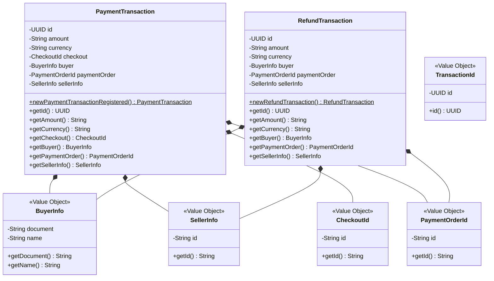

### 2. Service Layer Architecture

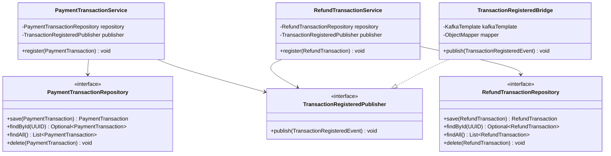

### 3. Controller and DTO Layer

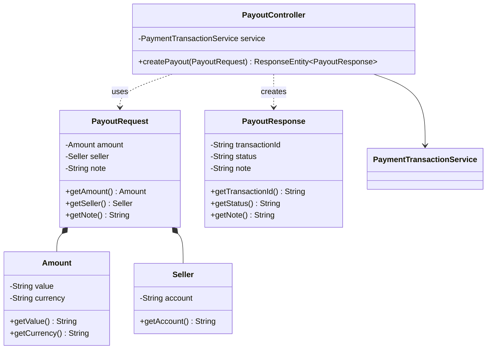

### 4. Event Architecture

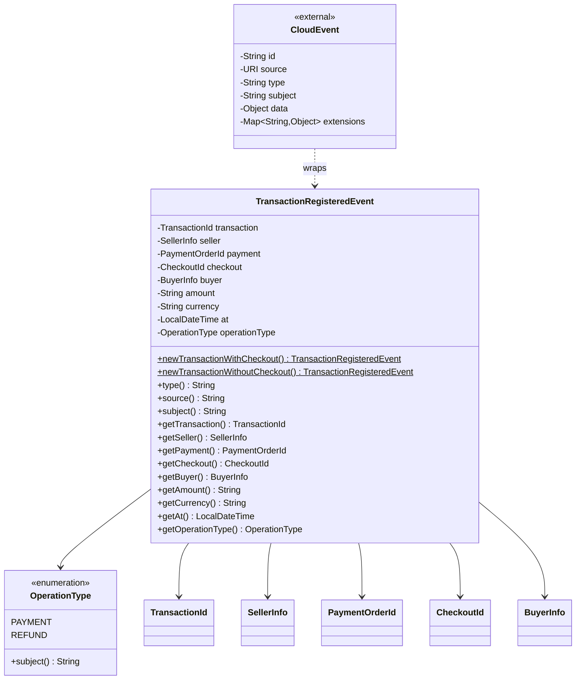

### 5. Kafka Adapter Architecture

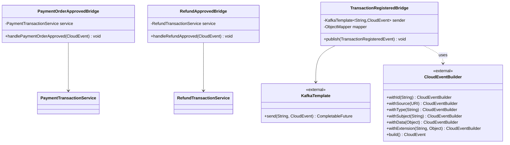

## Entity Relationship Diagram

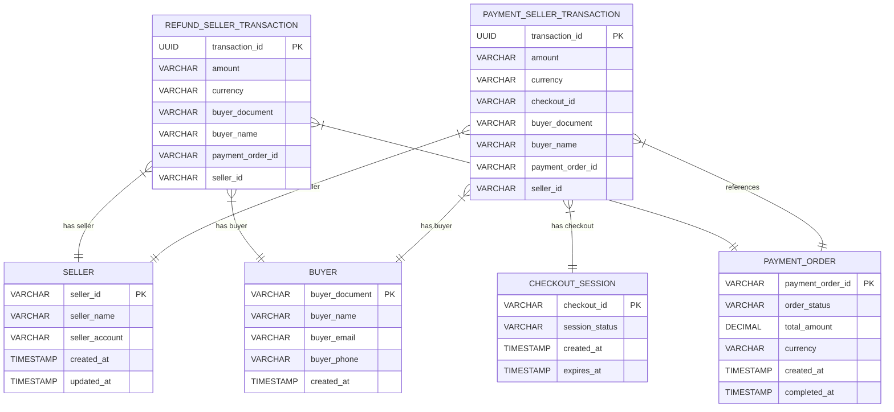

## Sequence Diagrams

### Use Case 1: Create Payout Transaction

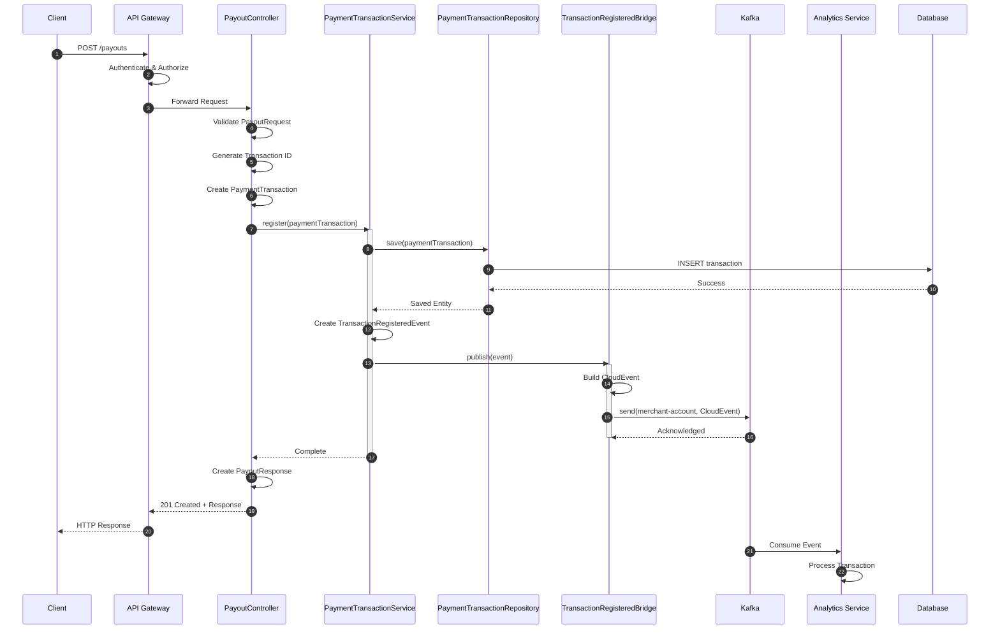

### Use Case 2: Process Payment Order Approved Event

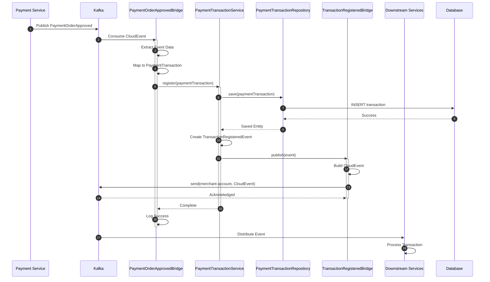

### Use Case 3: Process Refund Transaction

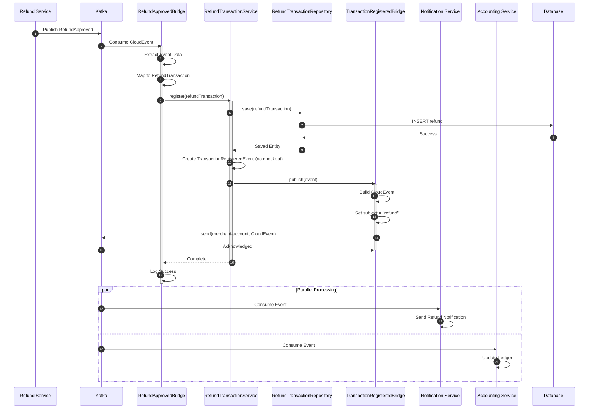

### Use Case 4: Transaction Query and Reporting

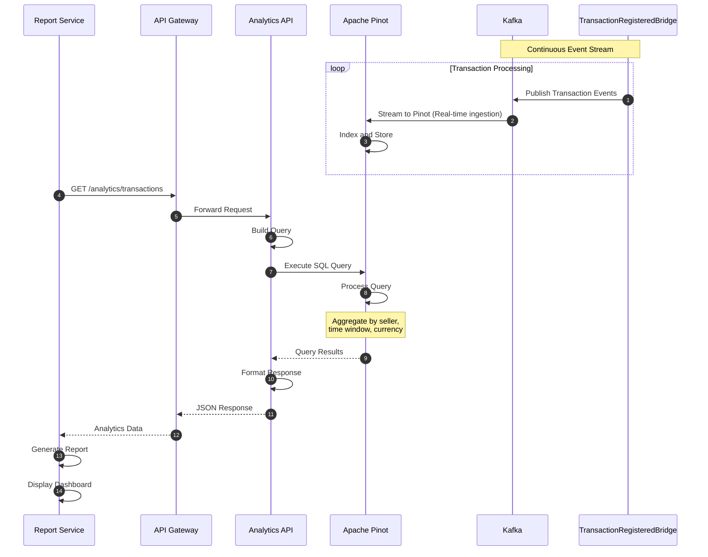

### Use Case 5: Error Handling and Compensation

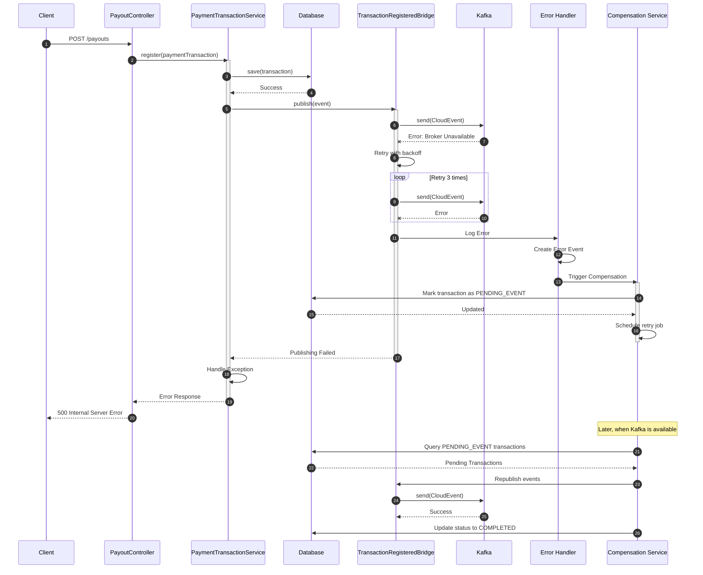

## Component Interaction Diagram

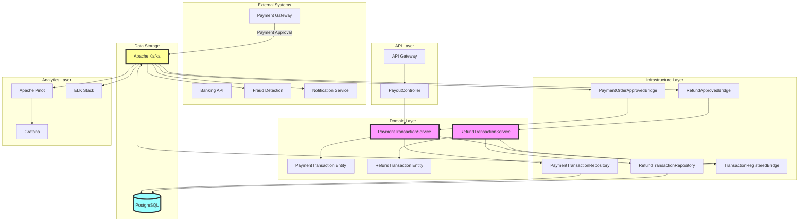

## Deployment Architecture

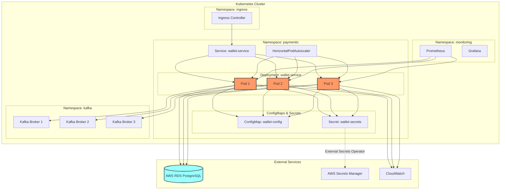

## Summary

These diagrams provide a comprehensive view of the Paymentic Wallet architecture:

1. **Class Diagrams** show the object-oriented structure and relationships between entities, services, and repositories
2. **Entity Relationship Diagram** illustrates the database schema and relationships
3. **Sequence Diagrams** demonstrate the flow of operations for the top 5 use cases:
   - Create Payout Transaction
   - Process Payment Order Approved Event
   - Process Refund Transaction
   - Transaction Query and Reporting
   - Error Handling and Compensation
4. **Component Interaction Diagram** provides a high-level view of system components and their interactions
5. **Deployment Architecture** shows how the system is deployed in a Kubernetes environment

These diagrams serve as essential documentation for understanding the system's structure, behavior, and deployment, making it easier for developers to work with and maintain the Paymentic Wallet service.